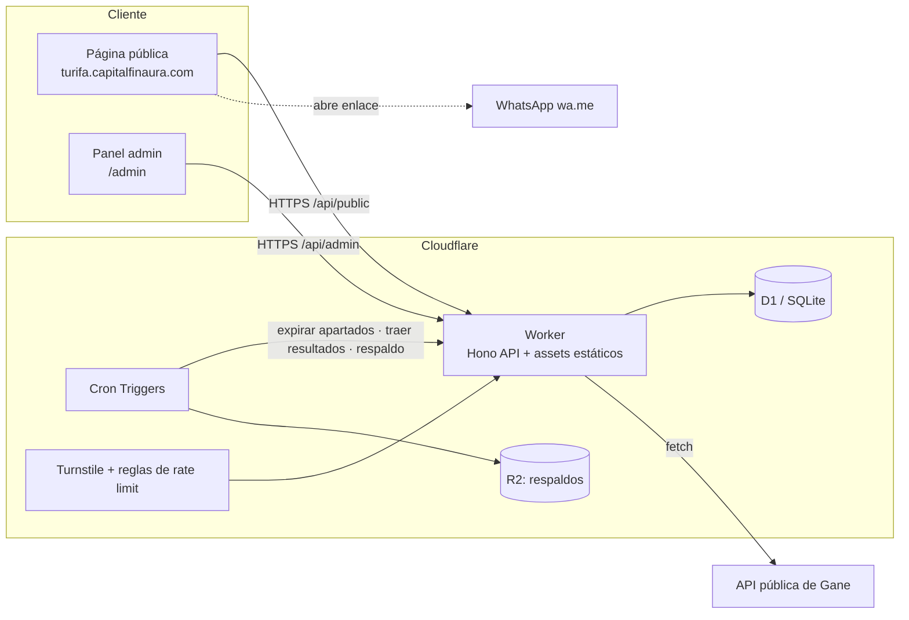

# Arquitectura de software

> Estado: propuesta aprobada para la Fase 0. Cualquier cambio relevante se registra en la sección *Decisiones*.

## 1. Principios
1. **Dominio puro y probado**: las reglas de negocio (estados de número, reservas, premios, calendario de sorteos) viven en TypeScript sin dependencias de infraestructura.
2. **Multi-tenant desde el día 1**: toda consulta lleva `org_id`; el aislamiento entre organizadores se prueba automáticamente.
3. **Correcto aunque falle lo programado**: nada crítico depende de que un cron corra a tiempo (p. ej. un apartado vencido se trata como libre al consultar).
4. **Costo cercano a $0**: solo servicios con plan gratuito suficiente; no añadir servicios de pago sin decisión explícita.
5. **Fuentes externas aisladas**: cada fuente de resultados es un adaptador reemplazable, con entrada manual de respaldo y trazabilidad.
6. **Datos personales mínimos**: el comprador entrega sus datos por WhatsApp, no en la web pública.
7. **Idioma**: interfaz y documentación en español (Colombia); código y nombres técnicos en inglés.

## 2. Vista general

Un solo **Worker** sirve la API (`/api/*`) y los archivos estáticos del frontend (Workers Static Assets). Una sola unidad de despliegue, un solo dominio, sin CORS.

## 3. Estilo: monorepo modular con capas (hexagonal ligera)
```
rifas-app/
├─ apps/
│  ├─ api/                  # Worker: composición, HTTP, cron
│  │  └─ src/
│  │     ├─ http/           # rutas Hono, middlewares (auth, tenant, rate limit), validación
│  │     ├─ jobs/           # handlers de Cron (expirar, resultados, respaldo)
│  │     ├─ infra/          # repositorios D1, cliente de Gane, reloj, ids
│  │     └─ index.ts        # fetch + scheduled
│  └─ web/                  # SPA Vite + Preact (público + admin)
├─ packages/
│  ├─ core/                 # DOMINIO + casos de uso (sin I/O)
│  │  └─ src/{raffles,tickets,prizes,draws,auth}/
│  ├─ lottery-sources/      # puerto LotterySource + adaptador Gane + calendario de sorteos
│  └─ contracts/            # esquemas zod y tipos del API (compartidos api ↔ web)
├─ migrations/              # SQL de D1 (numeradas, solo hacia adelante)
├─ e2e/                     # pruebas Playwright
├─ docs/
└─ .github/workflows/
```
**Regla de dependencias** (se garantiza declarando solo las dependencias permitidas en cada `package.json`; pnpm es estricto y un import no declarado falla):
`web → contracts` · `api → core, lottery-sources, contracts` · `lottery-sources → core` · `core → (nada)`.

### Capas dentro de `core`
- **Dominio**: entidades y reglas (`Ticket`, `Raffle`, `Prize`, `NumberFormat`, `PrizeRule`).
- **Casos de uso**: `reserveTickets`, `markSold`, `releaseTicket`, `expireReservations`, `evaluatePrizes`, `reschedulePrize`.
- **Puertos** (interfaces): `RaffleRepository`, `TicketRepository`, `DrawResultRepository`, `Clock`, `IdGenerator`.
La infraestructura (`apps/api/src/infra`) implementa los puertos con D1.

## 4. Decisiones técnicas
| Tema | Decisión | Motivo |
|---|---|---|
| Lenguaje | TypeScript estricto (`strict`, `noUncheckedIndexedAccess`) | Un solo lenguaje de punta a punta, tipos compartidos |
| Gestor | pnpm workspaces | Monorepo rápido y simple |
| API | Hono sobre Cloudflare Workers | Ligero, tipado, nativo de Workers |
| Validación | zod en `contracts` | Contrato único para API y web |
| BD | Cloudflare D1 (SQLite) | Gratis, suficiente (≤10 000 números por rifa) |
| Acceso a datos | SQL directo con consultas parametrizadas, repositorios propios | Control total de la atomicidad; evita ORM pesado en Workers |
| Frontend | Vite + Preact + Tailwind CSS | Bundle pequeño, rápido en móvil |
| Estado/routing web | `wouter` + `@preact/signals` | Mínimo necesario |
| Despliegue | `wrangler` desde GitHub Actions (rama `main`) | Reproducible y gratis |
| Lint/format | Biome | Una sola herramienta rápida |
| Pruebas | Vitest (unitarias), `@cloudflare/vitest-plugin` (API + D1 local en el runtime de Workers), Playwright (e2e, Fase 3) | Pirámide completa sin costo |
| Observabilidad | Workers Logs con logs JSON estructurados + alerta de errores | Diagnóstico sin servicios de pago |

## 5. Decisiones clave de diseño

### 5.1 Modelo disperso y reserva atómica de números
**Un número `activo` no tiene fila**: solo existen filas para `apartado` y `vendido`. Ventajas: crear una rifa de 10 000 números no escribe filas (D1 gratis permite 100 000 escrituras/día) y el historial/borrado se limita a lo que realmente se mueve. Los libres se deducen por rango (`0 … total-1`).

D1 no ofrece transacciones interactivas, así que la reserva es **una sola sentencia atómica** dentro de un `batch` transaccional:
1. Registrar (`expire`) y borrar los apartados vencidos entre los números pedidos.
2. `INSERT … SELECT value FROM json_each(:numeros) WHERE NOT EXISTS (SELECT 1 FROM tickets WHERE raffle_id=:r AND number IN (…))` → inserta **todos o ninguno**.
3. Registrar el evento `reserve` de las filas recién creadas.

Si las filas insertadas no igualan la cantidad pedida, se responde `409` con los números que ya no están libres. Verificado con pruebas de concurrencia (20 solicitudes simultáneas por los mismos números → exactamente una gana; solicitudes solapadas nunca dejan un número en dos reservas).

### 5.3 Premios (lógica B: terminaciones)
Un premio define lotería, `first`/`last` y 1 a *w* cifras (*w* = ancho de los números de la rifa). Se comparan **el mismo tramo** del número de la rifa y del resultado (de 4 cifras). Con menos cifras que el ancho pueden coincidir varios números; **cada número vendido que coincide es un premio entregado** (`apartado` y `activo` no ganan). Funciones puras en `packages/core/src/prize-rules.ts`.

### 5.4 Ciclo de un premio
Estados: `pendiente` → `anunciado` (con ganadores) o `finalizado` (sin ganador). La política la fija el admin por premio: `on_no_winner` = `reprogramar` | `finalizar` y `max_attempts` (o sin límite).
1. **Propuesta** (solo lectura): con el resultado del sorteo (oficial; si no, el manual de la organización) se calcula quién gana y se muestra al admin.
2. **Confirmación** (`resolvePrize`): se **recalcula en el servidor**. Con ganadores → se anuncian y se guarda una copia de los datos del comprador. Sin ganador → se finaliza, o —si la política y el máximo lo permiten— se **reprograma** a la fecha que elija el admin (solo días en que la lotería sortea y posterior a la anterior). Cada intento queda en `prize_draw_attempts`.
3. **Atómico**: todas las escrituras de la confirmación llevan la misma guarda (*el premio sigue pendiente con la misma fecha*); dos confirmaciones simultáneas no pueden registrarse ambas (probado con 10 en paralelo).

Un premio no se puede editar ni borrar una vez resuelto; la regla (lotería, tipo, cifras) tampoco tras el primer intento.

### 5.5 Resultados y fuentes
```ts
interface LotterySource {
  readonly enabled: boolean;                       // false = consulta automática apagada
  fetchDraws(date: string): Promise<SourceDraw[]>; // [] si aún no hay; lanza si la fuente falla
}
```
- **`GaneSource`** (`packages/lottery-sources`): ver [`GANE-API.md`](GANE-API.md). Normaliza a 4 cifras, mapea las variantes por día a un juego y es tolerante con filas raras.
- **Resultados** (`draw_results`): *oficiales* (globales, una fila por juego y día, nunca se sobrescriben) y *manuales* (de una organización, respaldo cuando la fuente falla; el oficial tiene prioridad y bloquea nuevos manuales). Se guarda el dato crudo y la fecha de captura.
- **Cron** (cada 10 min, solo si `LOTTERY_SYNC_ENABLED=true`): para los premios pendientes cuya fecha ya llegó y pasó la hora de publicación del juego, hace **una consulta por fecha** y guarda lo que falte. Un fallo de la fuente se cuenta y se reintenta, sin afectar lo demás.

### 5.6 Multi-tenancy
- Sesión admin → `org_id` desde la membresía. Ruta pública → `org` por slug/host.
- Los repositorios **exigen** `orgId` en cada método; no existe consulta sin tenant.
- Prueba automática de aislamiento: datos de la org A nunca visibles para la org B.

### 5.7 Autenticación y seguridad
**Administración (implementado en la Fase 2)**
- **Ingreso**: correo + contraseña. Hash PBKDF2-SHA256 con WebCrypto, 100 000 iteraciones (máximo de Workers), sal aleatoria y comparación en tiempo constante. Si el correo no existe se verifica igual contra un hash falso para no revelar qué correos existen.
- **Sesión**: cookie `rifas_session` (`HttpOnly`, `SameSite=Strict`, `Secure` en HTTPS) con un token aleatorio de 256 bits. En la base solo se guarda su **hash SHA-256** (si se filtra la base, los tokens no sirven). Dura 7 días; `Salir` la borra.
- **CSRF**: toda petición que modifica datos exige el encabezado `X-CSRF-Token` (entregado al iniciar sesión) y, si el navegador envía `Origin`, debe ser el mismo sitio.
- **Fuerza bruta**: 5 intentos fallidos por correo, o 20 por IP, en 15 minutos → `429`. Un ingreso correcto borra los fallos.
- **Aislamiento**: la organización sale siempre de la sesión, nunca de la petición; los recursos de otra organización responden `404`.
- **Alta de administradores**: no hay registro abierto. Se crean con `pnpm admin:create` (ver README); la contraseña se pide oculta y nunca queda en el historial del shell.
- El Cron limpia sesiones caducadas e intentos fallidos antiguos.

**Público (implementado en la Fase 3)** — capas contra abuso en `POST …/reservations`, en este orden:
1. **Límite de tasa por IP** (binding `RESERVE_LIMITER`, 20/minuto) → `429 rate_limited`.
2. **Turnstile** (anti-robots). **Falla cerrado**: con `REQUIRE_TURNSTILE=true` (valor de producción) un token ausente da `400`, inválido `403`, y si Cloudflare no responde o falta el secreto `503`; nunca se aparta sin verificar.
3. **Tope por solicitud**: máx. 10 números.
4. **Tope por cliente**: máx. 30 números apartados vigentes por rifa. Se aplica **dentro de la misma sentencia atómica** de reserva. El cliente se identifica con un **hash** de su IP (nunca se guarda la IP) → `429 too_many_reservations`.
Además: encabezados de seguridad en el API (`nosniff`, `no-referrer`, `X-Frame-Options`, `CORP`) y en la web (`_headers`: CSP estricta que solo admite `challenges.cloudflare.com` para Turnstile).

**General**
- Validación de toda entrada con zod y en el dominio; consultas siempre parametrizadas.
- Secretos solo como *secrets* de Cloudflare; `.env.example` sin valores reales.
- Encabezados de seguridad y CSP: implementados (ver arriba).

### 5.8 Tiempo
Todo se guarda en **UTC** (ISO 8601). Las fechas de sorteo y vencimientos se muestran en `America/Bogota`.

### 5.9 Enlace de WhatsApp
Se construye en el frontend con la respuesta de la reserva: `https://wa.me/<tel>?text=<mensaje codificado>` con rifa, números y código de apartado. El teléfono es configuración de la organización.

## 6. API (REST JSON, `/api/v1`)
| Zona | Rutas | Estado |
|---|---|---|
| Pública | `GET /public/:org/:rifa` · `GET /public/:org/:rifa/tickets` · `POST /public/:org/:rifa/reservations` | ✅ Fases 1 y 3 |
| Sesión | `POST /admin/login` · `POST /admin/logout` · `GET /admin/session` · `PATCH /admin/organization` | ✅ Fase 2 |
| Rifas | `GET/POST /admin/raffles` · `GET/PATCH /admin/raffles/:id` | ✅ Fase 2 |
| Números | `GET …/tickets` · `PUT …/tickets/:n/sale` · `PATCH …/tickets/:n/payment` · `DELETE …/tickets/:n` | ✅ Fase 2 |
| Apartados | `GET …/reservations/:código` · `POST …/reservations/:código/sale` (vende todos los números del código) | ✅ Fase 2 |
| Deudas / historial | `GET …/debts` · `GET …/history?number&beforeId&limit` | ✅ Fase 2 |
| Loterías | `GET /admin/lotteries` · `…/lotteries/:id/calendar` · `GET/PUT …/lotteries/:id/results/:fecha` · `POST …/results/:fecha/fetch` | ✅ Fase 4 |
| Premios | `GET/POST /admin/raffles/:id/prizes` · `PATCH/DELETE …/prizes/:premio` · `GET …/prizes/:premio/proposal` · `POST …/prizes/:premio/resolve` | ✅ Fase 4 |

- La zona pública **no expone datos del comprador ni deudas**; solo `{ number, status }` de los números no disponibles y, de los premios, el resultado y los números ganadores.
- Una rifa en `borrador` responde `404` igual que una inexistente. Una `cerrada` se ve en **solo lectura** (con los ganadores) y no admite apartados (`409 raffle_closed`).
- Toda la zona `/admin` exige sesión y responde con `Cache-Control: no-store`.
- Errores: `{ error: { code, message, details? } }` (`invalid_input` 400 · `unauthorized` 401 · `forbidden` 403 · `not_found` 404 · `numbers_unavailable`/`slug_taken`/`invalid_state` 409 · `too_many_attempts`/`too_many_reservations`/`rate_limited` 429 · `captcha_required` 400 · `captcha_failed` 403 · `captcha_unavailable` 503 · `raffle_closed`/`conflict` 409 · `source_unavailable` 502).
- La ruta de apartado aplica las protecciones descritas en §5.7.

## Página pública (`apps/web`)
Rutas: `/r/:org/:rifa` (elegir y apartar) y `/r/:org/:rifa/privacidad`. Tablero paginado de 200 en 200, filtro «solo disponibles», búsqueda de número, «al azar», máximo 10 por solicitud, total en pesos, refresco automático cada 30 s y al volver a la pestaña.
Muestra la sección **Premios** con el resultado y los **números ganadores** (nunca nombres ni teléfonos). Una rifa cerrada queda en solo lectura.
Al apartar: se verifica Turnstile, se reserva de forma atómica y se abre `https://wa.me/<teléfono sin +>?text=<mensaje>` con los números, el código de apartado, su vigencia y el enlace a la política de privacidad. Si el navegador bloquea la ventana, el panel de éxito ofrece el botón «Abrir WhatsApp». Si otro cliente ganó un número, se avisa y se refresca el tablero.

## Panel de administración (`apps/web`)
Pestaña **Premios**: crear/editar premios (fechas solo de días con sorteo), ver el resultado, confirmar y anunciar ganadores —avisando si alguno aún debe su número—, reprogramar si no hay ganador, o ingresar el resultado a mano.
SPA en `/admin`: ingreso, lista de rifas con avance y montos, creación de rifa, tablero de números (páginas de 200, salto directo a un número), venta pagada o con deuda y fecha, búsqueda de apartado por código para vender todos sus números de una vez, listado de deudas ordenado por fecha, historial paginado y ajustes (rifa y WhatsApp de la organización). Un apartado vencido se muestra como activo aunque el Cron aún no lo haya limpiado.

## 7. Entornos y despliegue
| Entorno | Datos | Cómo |
|---|---|---|
| Local | D1 local (miniflare) | `pnpm dev` |
| Producción | D1 de producción | CI despliega al hacer merge a `main`; migraciones aplicadas con `wrangler d1 migrations apply` antes del despliegue |

CI (GitHub Actions) en cada PR: `lint` → `typecheck` → pruebas unitarias/integración → build → e2e; en `main`: despliegue.
Respaldo: exportación diaria de D1 a **R2** (cron).

## 8. Estrategia de pruebas
- **Unitarias** (la mayoría): dominio en `core` (estados, reglas de premios, formato de números, calendario).
- **Integración**: API con D1 local, incluyendo reservas **concurrentes** y aislamiento multi-tenant.
- **Contrato**: adaptador de Gane contra respuestas reales guardadas (*fixtures*).
- **e2e** (pocas): flujo público (elegir → apartar → enlace WhatsApp) y flujo admin (vender → marcar deuda).

## 9. Fuera de alcance (por ahora)
Pagos en línea, cuentas de compradores, notificaciones push/correo, colas de mensajes, microservicios.
