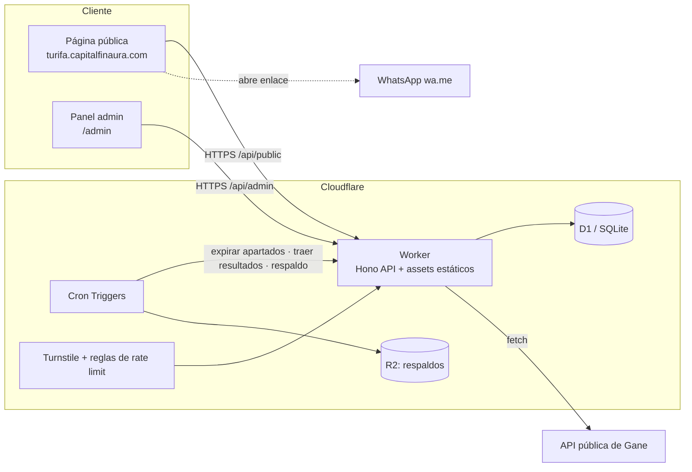

# Arquitectura de software

> Estado: propuesta aprobada para la Fase 0. Cualquier cambio relevante se registra en la sección *Decisiones*.

## 1. Principios
1. **Dominio puro y probado**: las reglas de negocio (estados de número, reservas, premios, calendario de sorteos) viven en TypeScript sin dependencias de infraestructura.
2. **Multi-tenant desde el día 1**: toda consulta lleva `org_id`; el aislamiento entre organizadores se prueba automáticamente.
3. **Correcto aunque falle lo programado**: nada crítico depende de que un cron corra a tiempo (p. ej. un apartado vencido se trata como libre al consultar).
4. **Costo cercano a $0**: solo servicios con plan gratuito suficiente; no añadir servicios de pago sin decisión explícita.
5. **Fuentes externas aisladas**: cada fuente de resultados es un adaptador reemplazable, con entrada manual de respaldo y trazabilidad.
6. **Datos personales mínimos**: el comprador entrega sus datos por WhatsApp, no en la web pública.
7. **Idioma**: interfaz y documentación en español (Colombia); código y nombres técnicos en inglés.

## 2. Vista general

Un solo **Worker** sirve la API (`/api/*`) y los archivos estáticos del frontend (Workers Static Assets). Una sola unidad de despliegue, un solo dominio, sin CORS.

## 3. Estilo: monorepo modular con capas (hexagonal ligera)
```
rifas-app/
├─ apps/
│  ├─ api/                  # Worker: composición, HTTP, cron
│  │  └─ src/
│  │     ├─ http/           # rutas Hono, middlewares (auth, tenant, rate limit), validación
│  │     ├─ jobs/           # handlers de Cron (expirar, resultados, respaldo)
│  │     ├─ infra/          # repositorios D1, cliente de Gane, reloj, ids
│  │     └─ index.ts        # fetch + scheduled
│  └─ web/                  # SPA Vite + Preact (público + admin)
├─ packages/
│  ├─ core/                 # DOMINIO + casos de uso (sin I/O)
│  │  └─ src/{raffles,tickets,prizes,draws,auth}/
│  ├─ lottery-sources/      # puerto LotterySource + adaptador Gane + calendario de sorteos
│  └─ contracts/            # esquemas zod y tipos del API (compartidos api ↔ web)
├─ migrations/              # SQL de D1 (numeradas, solo hacia adelante)
├─ e2e/                     # pruebas Playwright
├─ docs/
└─ .github/workflows/
```
**Regla de dependencias** (se garantiza declarando solo las dependencias permitidas en cada `package.json`; pnpm es estricto y un import no declarado falla):
`web → contracts` · `api → core, lottery-sources, contracts` · `lottery-sources → core` · `core → (nada)`.

### Capas dentro de `core`
- **Dominio**: entidades y reglas (`Ticket`, `Raffle`, `Prize`, `NumberFormat`, `PrizeRule`).
- **Casos de uso**: `reserveTickets`, `markSold`, `releaseTicket`, `expireReservations`, `evaluatePrizes`, `reschedulePrize`.
- **Puertos** (interfaces): `RaffleRepository`, `TicketRepository`, `DrawResultRepository`, `Clock`, `IdGenerator`.
La infraestructura (`apps/api/src/infra`) implementa los puertos con D1.

## 4. Decisiones técnicas
| Tema | Decisión | Motivo |
|---|---|---|
| Lenguaje | TypeScript estricto (`strict`, `noUncheckedIndexedAccess`) | Un solo lenguaje de punta a punta, tipos compartidos |
| Gestor | pnpm workspaces | Monorepo rápido y simple |
| API | Hono sobre Cloudflare Workers | Ligero, tipado, nativo de Workers |
| Validación | zod en `contracts` | Contrato único para API y web |
| BD | Cloudflare D1 (SQLite) | Gratis, suficiente (≤10 000 números por rifa) |
| Acceso a datos | SQL directo con consultas parametrizadas, repositorios propios | Control total de la atomicidad; evita ORM pesado en Workers |
| Frontend | Vite + Preact + Tailwind CSS | Bundle pequeño, rápido en móvil |
| Estado/routing web | `wouter` + `@preact/signals` | Mínimo necesario |
| Despliegue | `wrangler` desde GitHub Actions (rama `main`) | Reproducible y gratis |
| Lint/format | Biome | Una sola herramienta rápida |
| Pruebas | Vitest (unitarias), `@cloudflare/vitest-pool-workers` (API + D1 local, se incorpora en la Fase 1 junto con D1), Playwright (e2e, Fase 3) | Pirámide completa sin costo |
| Observabilidad | Workers Logs con logs JSON estructurados + alerta de errores | Diagnóstico sin servicios de pago |

## 5. Decisiones clave de diseño

### 5.1 Reserva atómica de números
D1 no ofrece transacciones interactivas, por lo que la reserva es **una sola sentencia** todo-o-nada:
```sql
UPDATE tickets
   SET status='apartado', reserved_at=:now, reserved_until=:until, reservation_code=:code
 WHERE raffle_id=:raffle AND number IN (:n1,:n2,...)
   AND (status='activo' OR (status='apartado' AND reserved_until < :now))
   AND (SELECT COUNT(*) FROM tickets
         WHERE raffle_id=:raffle AND number IN (:n1,:n2,...)
           AND (status='activo' OR (status='apartado' AND reserved_until < :now))) = :count;
```
Si `changes != count`, se informa qué números ya no están libres. El evento de historial se inserta en el mismo `batch` (transaccional). Los números se **materializan** al crear la rifa (máx. 10 000 filas, en lotes).

### 5.2 Expiración de apartados (24 h)
- **Lectura**: un `apartado` con `reserved_until < now` se trata como `activo` en todas las consultas (no depende del cron).
- **Cron** (cada 10 min): persiste la expiración y escribe el evento `expirado` en el historial.

### 5.3 Premios (lógica B)
Función pura `evaluatePrize(prizeRule, drawResult, tickets)`: devuelve los números que coinciden con la terminación (`first`/`last`, 1–4 cifras). Cada coincidencia es un premio entregado. Si no hay coincidencia o el número ganador no fue vendido, aplica la **política de la rifa** (§5.4).

### 5.4 Política configurable por premio
Cada premio define, a criterio del admin:
- `on_no_winner`: `reprogramar` (se evalúa con el próximo sorteo) o `finalizar` (el premio termina sin ganador).
- `max_attempts`: número de intentos permitidos, o sin límite (`null`).
La fecha de cada reintento la elige el admin y solo puede ser un día en que la lotería sortea (calendario del adaptador). Cada intento queda en `prize_draw_attempts`.

### 5.5 Fuentes de resultados
```ts
interface LotterySource {
  listLotteries(): Promise<Lottery[]>;
  getDrawsByDate(date: string): Promise<DrawResult[]>;   // normalizado
  getDrawCalendar(lotteryId: string, from: string, to: string): Promise<string[]>;
}
```
Adaptador inicial: `GaneSource` (ver [`GANE-API.md`](GANE-API.md)). Resuelve variantes por día (festivo/sábado). Los resultados publicados son inmutables → se cachean en D1 con el JSON crudo y su fecha de captura. Si la fuente falla: alerta y entrada manual.

### 5.6 Multi-tenancy
- Sesión admin → `org_id` desde la membresía. Ruta pública → `org` por slug/host.
- Los repositorios **exigen** `orgId` en cada método; no existe consulta sin tenant.
- Prueba automática de aislamiento: datos de la org A nunca visibles para la org B.

### 5.7 Autenticación y seguridad
- Admin: correo + contraseña (PBKDF2-SHA256 con WebCrypto, iteraciones al máximo que permite Workers), sesión en tabla `sessions`, cookie `HttpOnly; Secure; SameSite=Lax`, protección CSRF por token en mutaciones.
- Público: **Cloudflare Turnstile** + límite de tasa en `POST /api/public/reservations`; máximo de números por reserva y por IP/sesión.
- Validación de toda entrada con zod; consultas siempre parametrizadas.
- Secretos solo como *secrets* de Cloudflare; `.env.example` sin valores reales.
- Encabezados: CSP estricta, `X-Content-Type-Options`, `Referrer-Policy`.

### 5.8 Tiempo
Todo se guarda en **UTC** (ISO 8601). Las fechas de sorteo y vencimientos se muestran en `America/Bogota`.

### 5.9 Enlace de WhatsApp
Se construye en el frontend con la respuesta de la reserva: `https://wa.me/<tel>?text=<mensaje codificado>` con rifa, números y código de apartado. El teléfono es configuración de la organización.

## 6. API (REST JSON, `/api/v1`)
| Zona | Ejemplos |
|---|---|
| Pública | `GET /public/raffles/:slug` · `GET /public/raffles/:slug/tickets` · `POST /public/raffles/:slug/reservations` |
| Admin | `POST /admin/login` · CRUD `/admin/raffles` · `PATCH /admin/raffles/:id/tickets/:number` · `GET /admin/raffles/:id/history` · `POST /admin/prizes/:id/reschedule` · `GET /admin/lotteries/:id/calendar` |
Errores con formato uniforme `{ error: { code, message, details? } }`.

## 7. Entornos y despliegue
| Entorno | Datos | Cómo |
|---|---|---|
| Local | D1 local (miniflare) | `pnpm dev` |
| Producción | D1 de producción | CI despliega al hacer merge a `main`; migraciones aplicadas con `wrangler d1 migrations apply` antes del despliegue |

CI (GitHub Actions) en cada PR: `lint` → `typecheck` → pruebas unitarias/integración → build → e2e; en `main`: despliegue.
Respaldo: exportación diaria de D1 a **R2** (cron).

## 8. Estrategia de pruebas
- **Unitarias** (la mayoría): dominio en `core` (estados, reglas de premios, formato de números, calendario).
- **Integración**: API con D1 local, incluyendo reservas **concurrentes** y aislamiento multi-tenant.
- **Contrato**: adaptador de Gane contra respuestas reales guardadas (*fixtures*).
- **e2e** (pocas): flujo público (elegir → apartar → enlace WhatsApp) y flujo admin (vender → marcar deuda).

## 9. Fuera de alcance (por ahora)
Pagos en línea, cuentas de compradores, notificaciones push/correo, colas de mensajes, microservicios.
